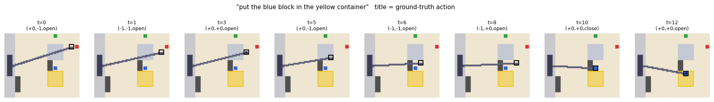
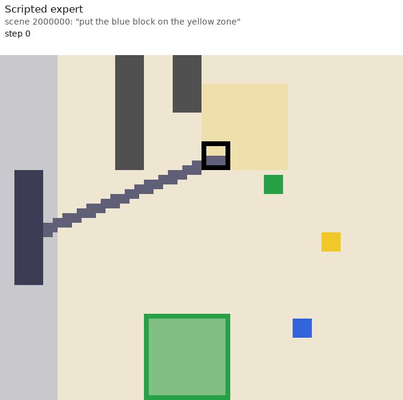
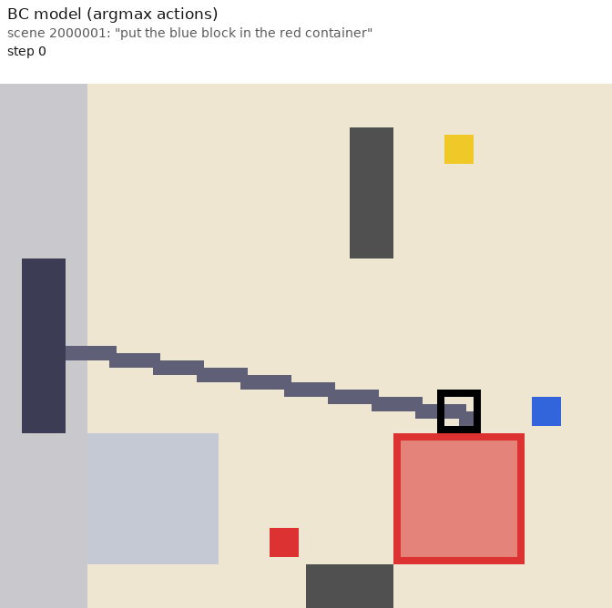
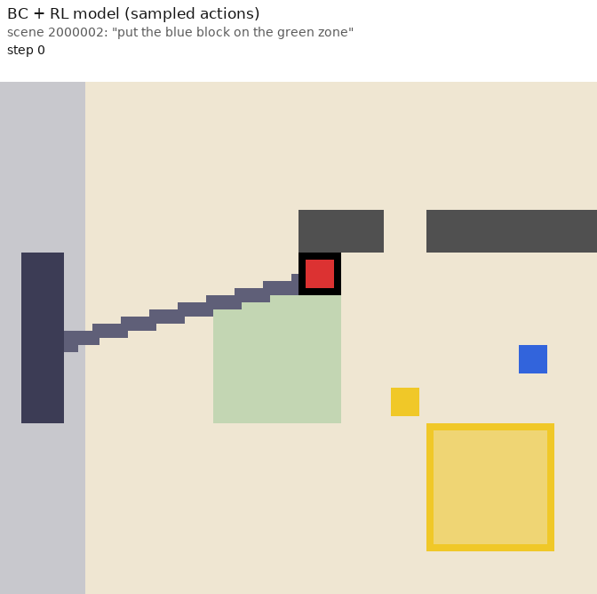
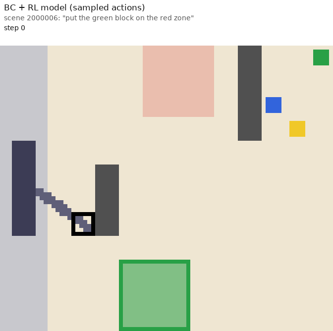
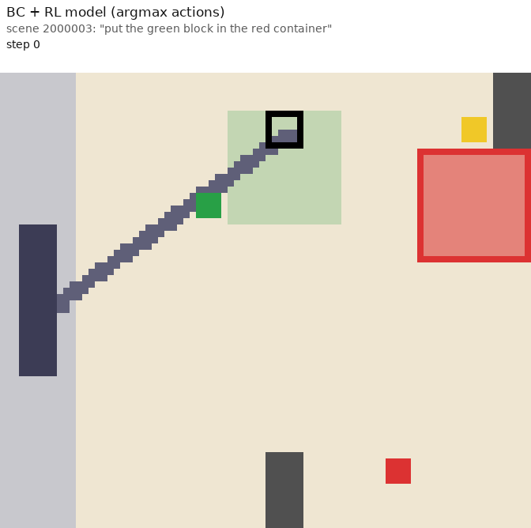
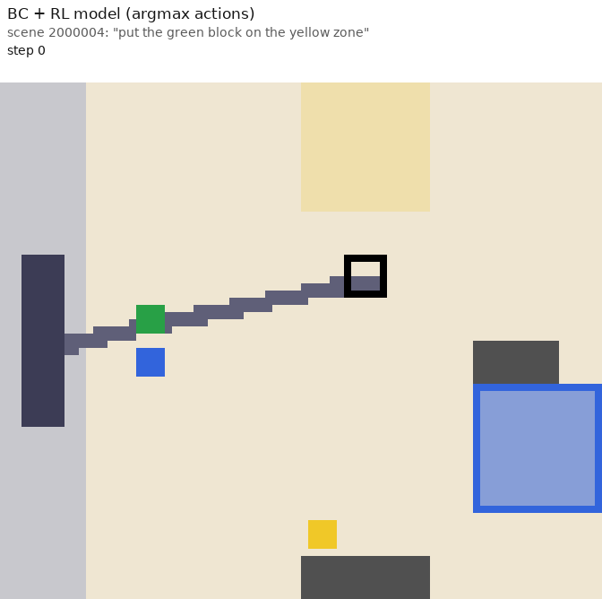

# Tiny VLA + RL: learning how Vision-Language-Action models are built, and how RL can improve them

A small, CPU/laptop-GPU-friendly **2D pick-and-place simulator** plus a **tiny Vision-Language-Action (VLA) model**, trained first with
behavior cloning (BC) and then fine-tuned with reinforcement learning (RL) using a **binary success reward**.
Everything is implemented Python + NumPy + PyTorch. 

> ## ⚠️ This project was made with AI
> **The code, the experiments' design, the debugging and this README were written with AI assistance** (Claude).
>
> What that means for you:
> * Treat this as a **learning project, not a reference implementation.** Expect rough edges and some leftover legacy scripts.
> * Interpretations of *why* things happened (see "What we learned") are **hypotheses**, not proven results.

## Goal

The main goal is **educational**: to understand

1. how a VLA is built and implemented (image + language + time → transformer → discrete action tokens), and
2. how RL can improve a behavior-cloned VLA, as proposed in
   [**SimpleVLA-RL: Scaling VLA Training via Reinforcement Learning**](https://github.com/PRIME-RL/SimpleVLA-RL),
   by reproducing the *ideas* (outcome-only reward, group sampling, dynamic sampling, clip-higher) at a very small scale.

It is **not** an attempt to reproduce that paper's numbers, and the toy results here should not be compared with them.

## The toy world



* 12×12 table seen from above (plus a 2-cell margin showing the robot base). 3 coloured blocks, one 3×3 container and one 3×3 goal zone, and a few wall obstacles.
* The observation is a **72×84 RGB image**, a **text instruction** such as *"put the blue block in the yellow container"*, and the **time step**.
* The action is `(dx, dy, grip)` with `dx, dy ∈ {-1, 0, 1}` and `grip ∈ {open, close}`. Episodes last at most 60 steps.
* **Success** = the named block is released inside the named region.
* A scripted **expert** (shortest-path planner) provides ground-truth actions; it is also what generates the training data.
* **Reward for RL:** 1 if and only if the episode succeeds, otherwise 0. No shaping, no step cost, no collision penalty.

## Demo GIFs

Generated with `python make_gifs.py` (see "Running it"). Each frame is captioned with the policy, scene, instruction, step, action and result.
By default every GIF gets its own scene (`--scene-mode distinct`); `python make_gifs.py --scene 2000005` instead shows all policies on one
scene so you can compare them directly (outcomes are then whatever the policies do).
They illustrate behaviour and are not a statistical comparison; see the results table for numbers.

| Scripted expert (success) | BC model, argmax (success) |
|:---:|:---:|
|  |  |

| BC + RL, **sampled** actions: success | BC + RL, **sampled** actions: failure |
|:---:|:---:|
|  |  |

| BC + RL, **argmax** actions: success | BC + RL, **argmax** actions: failure |
|:---:|:---:|
|  |  |

## How the tiny model maps onto a real VLA

| Real VLA (e.g. OpenVLA) | This repo (`simple_vla_chunk.py`) |
|---|---|
| Vision encoder → image tokens | 6×6 patch embedding: **one token per grid cell** (168 tokens) + row/column position embeddings |
| Language tokens | 8 word tokens (12-word vocabulary) |
| Proprioception / time | one time token |
| Transformer backbone | 4-layer, 4-head, d_model 128 transformer (~0.85 M parameters) |
| Discretised action tokens | categorical heads: `dx` (3), `dy` (3), `grip` (2) |
| Action chunking (ACT-style) | **K = 4 learned query tokens**, one per future step; replan every step, or run the chunk open-loop, or ensemble overlapping chunks |
| (not in real VLAs) | auxiliary "where is everything" head, plus a **dense per-image-token grounding loss** (which token is the end-effector / the target block / the target region) |

Pipeline:

```
scripted expert ──► demonstrations (.npz) ──► behavior cloning (train_chunk.py)
                                                    │
                      (optional) DAgger ◄───────────┤
                                                    ▼
                         RL fine-tuning, binary success reward (rl_grpo_chunk.py)
                                                    │
                                                    ▼
                           watch it act (watch_policy.py)
```

## Results (single runs; read the caveats)

Hardware: NVIDIA GTX 1650 Ti (4 GB), Windows + PowerShell. A BC epoch takes ~23 s (it slowed to ~79 s partway through one re-run, probably laptop GPU throttling or another process; results were unaffected), an RL iteration ~15–30 s.
Data: 1000 scripted-expert training episodes (14,592 rows). "Sampled" = actions sampled from the policy; "argmax" = most likely action.

| Model | Scenes | Sampled | Argmax |
|---|---|---|---|
| BC, K=4 chunks, H=0 (`g0_chunk.pt`), replan every step | 100 new | 0.88 | 0.69 |
| BC, same model, open-loop 4 steps | 100 new | 0.84 | 0.75 |
| BC **re-run** with the README commands (fresh training, same settings), replan every step | 100 new | 0.88 | 0.71 |
| BC re-run, open-loop 4 steps | 100 new | 0.86 | 0.77 |
| BC, same model, start of the GRPO run | 200 eval | 0.84 | 0.695 |
| + PPO with a learned critic, 100 iters (`rl_train_chunk.py`) | 100 new | 0.88 | 0.62 |
| + GRPO-style RL, 60 iters (`rl_grpo_chunk.py`), eval during training | 200 eval | **0.885** | **0.405** |
| + GRPO-style RL, final test of best checkpoint | 200 new | 0.92 | 0.38 |

**Reproduction check.** Re-running the BC step (3 below) on the dataset from step 1 gave the same picture (replan-every-step 0.71 argmax / 0.88 sampled;
open-loop-4 0.77 / 0.86; with 100% cell-level grounding accuracy), so the BC pipeline reproduces. It also shows the run-to-run noise: the
temporal-ensemble mode scored 0.44 argmax in the first training and 0.55 in the re-run with identical settings, so differences of several
points between two single runs should not be over-read. Note that re-running with `--best-path g0_chunk.pt` overwrites the old checkpoint, so
**an RL result is only comparable to the BC model it started from**; copy `g0_chunk.pt` somewhere safe before retraining.

Caveats: the standard error of a success rate measured on 200 scenes is about ±2.5 points, so the +4.5-point gain in the
sampled policy (0.84 → 0.885) is only suggestive. The final 0.92 was measured on a different scene set and the BC baseline was *not* measured on
those same scenes, so it is not an apples-to-apples comparison (see "Next steps").

## What we learned

1. **Grounding was the bottleneck, not model size.** Early BC runs predicted `dx`/`dy` at only ~50% accuracy and closed-loop success was ~2%.
   The "where-is-it" auxiliary head sat at chance level for the region. Adding a **dense per-image-token grounding loss** (every image token
   predicts "I am the end-effector / the target block / part of the target region") fixed that, and closed-loop success jumped.
2. **Offline accuracy is not closed-loop success.** Feeding past actions as history raised offline accuracy but did not help in the simulator
   (a copycat-style shortcut is the likely reason, an untested hypothesis). The final model uses `H = 0`.
3. **Always evaluate in the loop, on unseen scenes, with enough episodes.** 100-scene evaluations are noisy (±4 points).
4. **RL on an already-strong BC policy gives small gains.** A PPO + critic setup showed no improvement. GRPO-style group advantages
   (several attempts per scene, compared within a scene; scenes with all-same outcomes dropped; hard-scene replay; clip-higher; KL to the BC
   model on the other chunk steps) gave a small gain in the *sampled* policy. In the SimpleVLA-RL paper, RL starts from a much weaker SFT policy
   with far more rollout budget, which is probably why its gains are larger. That comparison is my reading, not something tested here.
5. **RL improved the sampled policy but broke the argmax policy.** Entropy rose from ~0.43 to ~0.8, the executed step drifted far from the BC
   model, and the greedy policy loops/bumps into walls (13 bumps per episode). Hypothesis: the scenes that carry learning signal are those where the
   policy sometimes escapes a stuck state by luck, so RL learned to be more random. Use `watch_policy.py --mode greedy` to look at it.
6. **BC never saw recovery situations from its own mistakes** (no DAgger was used for the models above), which probably contributes to the
   stuck/looping behaviour. `dagger_chunk.py` exists but has not been run or validated.

## Setup (Windows / PowerShell; Linux and macOS are the same except for the activate line)

```powershell
# 1) Python 3.10+ and a virtual environment
python -m venv vla-env
vla-env\Scripts\activate           # Linux/macOS: source vla-env/bin/activate
                                   # if PowerShell blocks it:  Set-ExecutionPolicy -Scope CurrentUser RemoteSigned

# 2) light dependencies
pip install -r requirements.txt
pip install pyqt5                  # only if the matplotlib windows do not open (human_collect.py / watch_*.py)

# 3) PyTorch with CUDA  -> pick the exact command at https://pytorch.org/get-started/locally/
#    (example for CUDA 12.1 wheels; the CUDA version must be supported by your NVIDIA driver, see `nvidia-smi`)
pip install torch --index-url https://download.pytorch.org/whl/cu121

# 4) check the GPU is visible
python -c "import torch; print(torch.__version__, torch.cuda.is_available(), torch.cuda.get_device_name(0))"
```

If `torch.cuda.is_available()` is `False`: you probably have the CPU-only wheel. `pip uninstall torch`, reinstall with the CUDA index URL above,
and check that the driver is up to date. Every script accepts `--device cpu|cuda|auto`; CPU works but is much slower.

## Running it, step by step

All commands are run from the repo folder with the virtual environment active.

```powershell
# --- 1. generate scripted-expert demonstrations (10% random executed actions create "recovery" data; labels stay expert)
python make_dataset.py collect --train 1000 --val 100 --test 100 --out expert_data.npz
python make_dataset.py inspect --data expert_data.npz          # summary + episode_preview.png
#     (the stored `reward` column is the env's *shaped* reward; training never uses it. RL uses the binary success reward only.)

# --- 2. (optional) watch the expert, or collect your own human demos with the keyboard
python watch_data.py --mode live
python watch_data.py --mode replay --data expert_data.npz --episode 0
python human_collect.py --out human_data.npz --episodes 25     # arrows/WASD move, Q E Z C diagonals, SPACE gripper, BACKSPACE undo, ESC quit

# --- 3. behavior cloning of the chunking VLA  (the first run builds chunk targets and caches them next to the data file)
python train_chunk.py --data expert_data.npz --K 4 --H 0 --epochs 30 --best-path g0_chunk.pt
#     add  --human human_data.npz  to mix in your demos;   --eval-only g0_chunk.pt  to re-test a saved model

# --- 4. RL fine-tuning with a binary success reward
python rl_grpo_chunk.py --init g0_chunk.pt --iters 2 --scenes 4 --group 4 --eval-episodes 10 --eval-every 1 --final-episodes 10   # smoke test
python rl_grpo_chunk.py --init g0_chunk.pt                      # real run (60 iterations)
python rl_grpo_chunk.py --init g0_chunk.pt --kl0 0.1 --best-path vla_grpo_kl_best.pt --last-path vla_grpo_kl_last.pt   # untested idea: keep argmax healthier
python rl_grpo_chunk.py --init g0_chunk.pt | Tee-Object rl_log.txt    # also save the log

# --- 5. watch the trained policy act in the simulator
python watch_policy.py --ckpt vla_grpo_chunk_best.pt            # live window, sampled actions
python watch_policy.py --ckpt vla_grpo_chunk_best.pt --mode greedy
python watch_policy.py --ckpt g0_chunk.pt                       # the BC model, for comparison
python watch_policy.py --ckpt vla_grpo_chunk_best.pt --only-fail --episodes 5
python watch_policy.py --ckpt vla_grpo_chunk_best.pt --gif-dir gifs --no-window --episodes 20

# --- 5b. captioned demo GIFs: expert, BC success, RL (sampled / argmax) success + failure -> gifs_demo/
python make_gifs.py --bc-ckpt g0_chunk.pt --rl-ckpt vla_grpo_chunk_best.pt

# --- 6. (not yet run) DAgger: let the model drive, let the expert label the states it reaches, retrain
python dagger_chunk.py --policy g0_chunk.pt --episodes 300 --beta 0.3 --out dagger_c1.npz
python train_chunk.py --data expert_data.npz --extra dagger_c1.npz --K 4 --H 0 --epochs 30 --best-path g0_dag1.pt
```

Checkpoints, datasets and caches (`*.pt`, `*.npz`) are git-ignored; regenerate them with the commands above.

### Reading the RL log

```
iter  12 | eps 2304 | train succ 0.54 (fresh scenes 0.74) | mixed scenes 11/24 | hard pool 36 | len 38 | steps 4453 ent 0.47 kl 0.0071 clip 0.09 klref0 0.0959 klref_rest 0.0104
```

| Field | Meaning |
|---|---|
| `train succ` / `fresh scenes` | success of this batch; the *fresh-scene* number is the unbiased one (the rest includes remembered hard scenes) |
| `mixed scenes N/24` | scenes where the 8 attempts disagreed, i.e. the only ones that produce a learning signal |
| `hard pool` | number of remembered scenes the policy sometimes fails |
| `ent` | policy entropy; a steady rise means the policy is getting more random |
| `kl` / `clip` | how far the policy moved this iteration (PPO bookkeeping); `--target-kl` stops the update early |
| `klref0` | drift of the *executed* step from the BC model (not penalised unless `--kl0 > 0`) |
| `klref_rest` | drift of chunk steps 1–3 and the grounding head (penalised by `--keep-coef`) |
| `>> eval` | success on 200 fixed unseen scenes, sampled and argmax |

### Troubleshooting

* **A script exits immediately with no output.** The file is probably truncated or an old copy. Compare line counts
  (`(Get-Content train_chunk.py).Count`) against the repo version and re-download.
* **"g0.pt not found".** `--best-path` is an *output* name. Use `--init <ckpt>` (RL), `--policy <ckpt>` (DAgger), `--ckpt <ckpt>` (viewer), `--eval-only <ckpt>` (BC test).
* **CUDA out of memory (4 GB card).** Lower `--minibatch 64` (RL) or `--batch-size 64 --data-on-cpu` (BC).
* **`torch.cuda.is_available()` is False.** See Setup step 3.
* **Matplotlib window does not open.** `pip install pyqt5`.

## File map

| File | What it is |
|---|---|
| `pickplace_env.py` | The simulator: scene generation, rendering, step/reward, scripted expert, evaluation helper |
| `make_dataset.py` | Collect / inspect / merge demonstration datasets (`.npz`) |
| `vla_data.py` | Tokenizer (12-word vocab), loading datasets into arrays, auxiliary "where is everything" labels |
| `chunk_data.py` | Builds action-chunk targets (replans the expert from the exact stored state) and history inputs; grid-token helpers; temporal ensembling |
| `simple_vla_chunk.py` | **The model:** chunking VLA with K query tokens, optional history tokens, aux head and per-token grounding head |
| `train_chunk.py` | **Behavior-cloning training and closed-loop evaluation** of the chunking model (replan1 / open-loop / ensemble modes, failure-stage trace) |
| `rl_grpo_chunk.py` | **Current RL script:** binary success reward, group-relative advantages, dynamic sampling, hard-scene replay, clip-higher, KL on the other chunk steps |
| `watch_policy.py` | Watch a trained checkpoint act in the simulator (live window or GIFs) |
| `make_gifs.py` | Renders captioned demo GIFs: expert, BC success, and RL success/failure with sampled and argmax actions |
| `human_collect.py`, `watch_data.py` | Keyboard demo collector; replay/watch the expert or a stored dataset |
| `dagger_chunk.py` | DAgger collector for the chunking model (written, not yet run) |
| `rl_train_chunk.py`, `chunk_vec_env.py` | Earlier PPO + critic RL for the chunking model (no measurable gain); its vectorised environment |
| *legacy, single-action model* | `simple_vla.py` (original skeleton), `simple_vla_v2.py`, `simple_vla_v2_modified.py`, `train_vla.py` (also holds shared helpers `get_device`, `lr_at`), `rl_train_vla.py`, `vec_env.py`, `dagger_collect.py`, `run_dagger.py` |

## Limitations and next steps

* Single seed, small evaluation sets. Next: run the BC model and the RL model on the **same** 500+ scenes, and with 2–3 seeds.
* Run DAgger for the chunking model and see whether the argmax policy improves *before* RL.
* Try RL from a deliberately weaker BC model (e.g. 50–100 expert episodes), the regime where the papers report large gains.
* Try `--kl0`, `--ent-coef`, larger `--group`, and multiple RL seeds; consider evaluating with a temperature instead of argmax.
* The simulator is deliberately simple (grid world, one block per task, no physics). Conclusions may not transfer to real robots or large VLAs.

## References

* SimpleVLA-RL: Scaling VLA Training via Reinforcement Learning. <https://github.com/PRIME-RL/SimpleVLA-RL> (the idea being explored; please read the paper for the real method and results)
* *What Can RL Bring to VLA Generalization? An Empirical Study.* <https://arxiv.org/abs/2505.19789>
* OpenVLA; ACT / action chunking (Zhao et al., 2023); DAgger (Ross et al., 2011); GRPO (DeepSeekMath). Cited from memory; please check the originals.
